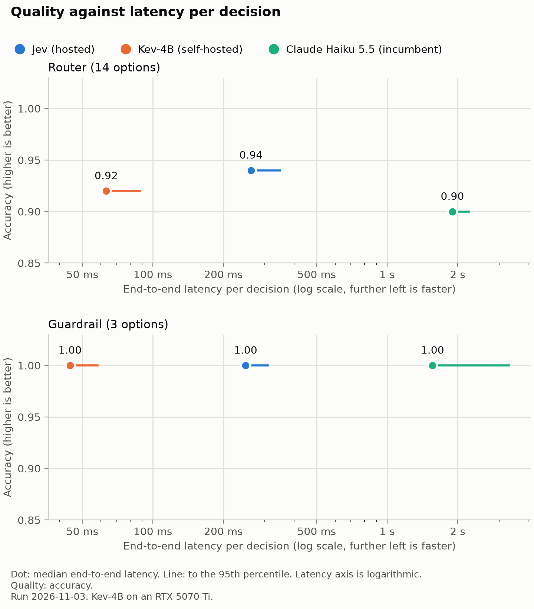
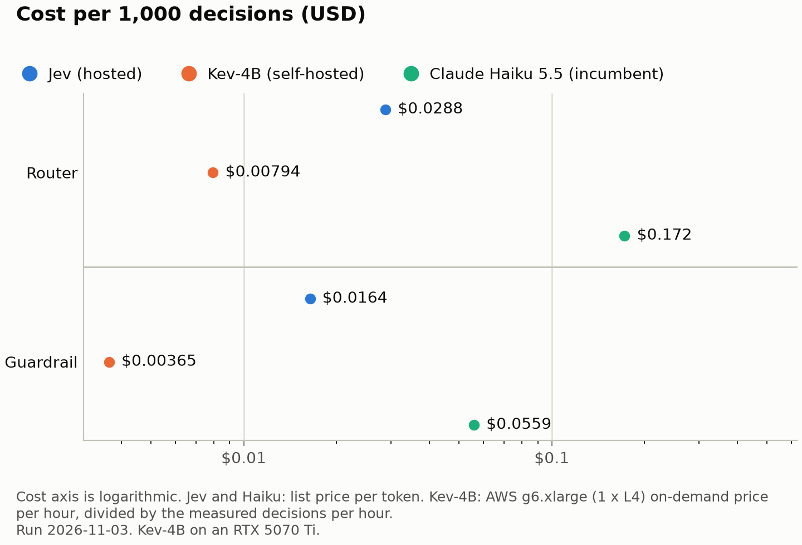

<div align="center">

# think-fast-jev

**Can a single-pass model take the decision layer of a crypto market-data assistant from a frontier LLM?**

[Headline](#headline) • [Results](#results) • [Method](#method) • [Limitations](#limitations) • [Reproduce](#reproduce)

</div>

A small, reproducible benchmark. It compares single-pass decision models ([Jev](https://typesafe.ai) and its open-weight
clone [Kev](https://github.com/jaredpalmer/kev)) with Claude Haiku 5.5 on quality, calibration, latency and cost.

**Powered by [CoinGecko](https://www.coingecko.com/en/api).** Not affiliated with or endorsed by CoinGecko or TypeSafe.

## Headline

<!-- After the full run: the answer in 2-3 sentences, with the three numbers for each node. Say where the candidates lose. -->
> [!NOTE]
> The full run is in progress. The answer goes here when it ends.

## Results

<!-- After the full run: paste results/scores.md here, then run `bench chart`. -->
_The results table goes here after the full run._





## Method

Before an assistant like this writes an answer, it makes small decisions: which data tool to call, and whether it may
answer at all. This benchmark tests whether a model built only for such choices can make them as well as a frontier LLM.

Jev and Kev do not generate text. They return a probability for each option from one prefill pass.

### Decision nodes

Each node runs on its own: an item goes in, a decision comes out. There is no assistant pipeline and no answer
generation.

| Decision node | Input | Options |
|---|---|---|
| Router | A user question | 14: 13 data-tool areas of the public CoinGecko API, and `unsupported` |
| Guardrail | A user question | 3: `allow`, `advice`, `off_topic` |
| Coin sector | A coin: name, symbol and description | 14 sectors, one yes/no question each |

Option names and descriptions are in [`src/bench/nodes.py`](src/bench/nodes.py). Every arm gets the same item text and
the same options in the same order.

### Arms

| Arm | Role | Model | How the benchmark calls it |
|---|---|---|---|
| Claude Haiku 5.5 | Incumbent | `claude-haiku-5-5` | Anthropic API. Thinking disabled, effort `low`. Structured output with one probability per option. 3 runs per item. |
| Jev | Candidate | `jev-latest` | TypeSafe System One API. One prefill pass. |
| Kev-4B | Candidate | `kev-latest` (checkpoint `jaredpalmer/kev-4b`) | The Kev server on a local GPU. Same API as Jev. |

### Data

- **Router and guardrail:** 150 user questions, each with a router label and a guardrail label. The set is on Hugging
  Face: <!-- dataset link after `bench export` and upload -->_link after publication_.
- **Coin sector:** the top 200 coins by market cap from the CoinGecko API, without the coins that have no description.
  The labels are each coin's current CoinGecko categories, mapped to the 14 sectors in `nodes.py`.

### Procedure

- The runner calls one arm at a time and finishes one item before the next. The arm order rotates per item.
- The first 3 calls of each arm in each `bench run` are warm-up and do not count toward the latency metrics. For Kev, the
  keep-warm calls count as calls.
- A failed call gets up to 3 attempts. After that, the runner records an error.
- Haiku runs each item 3 times. The main scores use only its first run, so Haiku gets no voting advantage. A separate
  row shows the majority of the 3 runs.
- Quality scores use only the items that every arm answered validly.
- `bench permute` asks Jev and Kev each router and guardrail item under 6 option orders: the original order and 5
  shuffled orders.
- `bench throughput` measures Kev's decisions per hour with 32 calls at a time. This number gives Kev's cost.

### Metrics

| Metric | Meaning |
|---|---|
| `accuracy` | Router and guardrail: the share of items where the selected option is the label. |
| `macro_f1` | Coin sector: the mean F1 over the sectors, with yes at a probability of 0.5 or more. |
| `brier` | Calibration. 0 is perfect. Router and guardrail: multi-class (2 is the worst). Coin sector: per yes/no question (1 is the worst). |
| `agreement` | Haiku: the share of items where all 3 runs selected the same answer. |
| `order_stable` | Jev and Kev: the share of items where all option orders selected the same option. |
| `order_spread` | Jev and Kev: the mean of the largest change of one option's probability between the option orders. |
| `model_p50`, `model_p95` | Model time in ms, median and 95th percentile. |
| `e2e_p50`, `e2e_p95` | End-to-end time in ms as the client measures it, median and 95th percentile. |
| `cost_per_1k` | USD per 1,000 decisions. |
| `error_rate` | The share of decisions with an error. |

### Setup

<!-- After the full run: date, model versions from the run metadata, and the client location. -->
- **Run date:** _after the run_.
- **Model versions:** _from the run metadata_. `jev-latest` is an alias, so the run records the version that each
  response reports.
- **Client:** a Mac in Malaysia. Jev and Haiku go over the internet. Kev goes over the local network.
- **Kev server:** RTX 5070 Ti (16 GB), WSL2 Ubuntu 24.04, PyTorch 2.8.0, `KEV_PREFIX_CACHE=1`.
- **Prices:** Jev $0.042 per 1M input tokens, output free. Haiku $0.10 per 1M input tokens and $0.50 per 1M output
  tokens. Kev: AWS g6.xlarge (1 x L4) on-demand in us-east-1, $0.8048 per hour.

## Limitations

- **Haiku's probabilities are self-reported.** The Anthropic API gives no logprobs and Haiku 5.5 does not accept a
  temperature. Haiku writes one number per option in structured output. For the router and the guardrail, the client
  scales these numbers to sum to 1, and Haiku's Brier score measures the scaled numbers.
- **Haiku runs at its lowest reasoning setting:** thinking disabled and effort `low`. A higher setting can change its
  quality, latency and cost.
- **Model time is not the same measure for each arm.** Hosted Jev returns no model time, so Jev has only end-to-end
  time. Haiku's model time is the origin time in the `server-timing` header at the Cloudflare edge, which includes
  Anthropic's internal network. Kev's model time is the `latency_ms` field of its server.
- **End-to-end time depends on the location.** Jev and Haiku go from Malaysia over the internet. Kev goes over the local
  network.
- **Kev gets a keep-warm call.** On the test PC, Kev's model time rises from about 60 ms to about 180–290 ms after 8 s or
  more of idle. The runner sends one unrecorded call to Kev right before each recorded call. Without it, a production
  server with gaps between requests pays this idle penalty. With keep-warm, a few calls (about 7% in a test) still took
  300–500 ms, and these calls can reach Kev's p95.
- **Kev's cost is an estimate.** The throughput comes from an RTX 5070 Ti, not from the L4 in the g6.xlarge. The cost
  assumes that the GPU is busy all the time. In ap-southeast-5 (Malaysia), the g6.xlarge costs $1.0138 per hour.
- **Option order can change the answer.** The [TypeSafe docs](https://docs.typesafe.ai/primitives/choice) say that Jev
  1.13 can lean toward the first option. The main run uses one fixed order for every arm. `order_stable` and
  `order_spread` show the effect for Jev and Kev. This benchmark does not measure Haiku's option-order sensitivity.
- **The coin sector labels are CoinGecko's current categories.** Some coins do not have a category that fits them, so an
  arm that says yes to such a sector counts as wrong. Sectors with few coins give an unstable F1, and some sectors
  overlap, for example governance and DeFi. The labels are from the fetch date.
- **The query set is small.** Claude drafted the seed queries, with public example prompts for crypto data tools as a
  guide. Haiku is also a Claude model. A model that is not Claude wrote the variations.
- **The query set is not real user traffic.** The seeds cover each option about equally. Real users can ask for some
  options much more often, so the accuracy here is not a production number. The set leaves out multi-step questions and
  price predictions, because they do not have one clear label.
- **The error rate uses the last record per decision.** An error that a rerun fixed does not count. Kev's error rate
  includes failed keep-warm calls.
- **This is one run on one day.** Hosted models and their latency change over time.

## Reproduce

You need Python 3.12 and [uv](https://docs.astral.sh/uv/). Add your API keys to `.env`:

| Setting | Used for |
|---|---|
| `TYPESAFE_API_KEY` | Jev |
| `ANTHROPIC_API_KEY` | Claude Haiku 5.5 |
| `COINGECKO_API_KEY` | `bench fetch` (CoinGecko Demo API) |
| `KEV_BASE_URL`, `KEV_API_KEY` | Kev. Optional: start the [Kev server](https://github.com/jaredpalmer/kev) with `jaredpalmer/kev-4b`. |

Then run the benchmark:

```sh
uv sync
uv run bench check
uv run bench fetch
for node in router guardrail coin_sector; do uv run bench run --node "$node"; done
for node in router guardrail; do uv run bench permute --node "$node"; done
for node in router guardrail coin_sector; do uv run bench throughput --node "$node"; done
uv run bench score
uv run bench chart --note "Run 2026-11-03. Kev-4B on an RTX 5070 Ti."
uv run bench export
```

Scores go to `results/scores.csv` and `results/scores.md`, charts to `results/charts/`, and the dataset to
`dist/dataset/`.

> [!IMPORTANT]
> After a fresh start of the Kev server, do one throwaway run first, because the first calls are slow. Without the two
> Kev settings, the commands run without Kev, and `bench throughput` does not run.

> [!TIP]
> A rerun of `bench run` or `bench permute` skips the decisions that already have a result, so you can continue after a
> failure.
